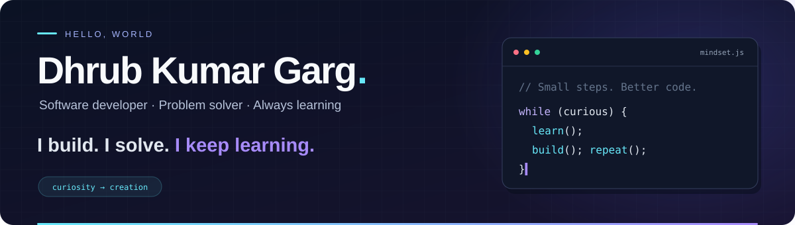

  

<h1 align="center">Hey, I'm Dhrub 👋</h1>

  

  
  &nbsp;
  
  &nbsp;
  

 

## ✦ A little about me

I'm a software developer who enjoys turning ideas into useful software. I like the challenge of solving a tricky problem as much as the process of bringing an interface to life.

- **Build:** Web applications with React, Next.js, Node.js, and Express.
- **Solve:** Coding challenges that sharpen my problem-solving skills.
- **Explore:** New technologies through hands-on projects and experimentation.

> My approach: stay curious, build something, and make it better.

 

## ⚡ My tech stack

<table width="100%">
  <tr>
    <th align="left">Area</th>
    <th align="left">Technologies</th>
  </tr>
  <tr>
    <td><b>Languages</b></td>
    <td> C++ · C · Java · JavaScript</td>
  </tr>
  <tr>
    <td><b>Frontend</b></td>
    <td> React · Next.js · HTML5 · CSS3 · Tailwind CSS</td>
  </tr>
  <tr>
    <td><b>Backend</b></td>
    <td> Node.js · Express</td>
  </tr>
  <tr>
    <td><b>Databases</b></td>
    <td> MongoDB · MySQL</td>
  </tr>
  <tr>
    <td><b>Cloud &amp; deployment</b></td>
    <td> Firebase · Vercel · Google Cloud</td>
  </tr>
  <tr>
    <td><b>Developer tools</b></td>
    <td> Git · GitHub · VS Code</td>
  </tr>
</table>

 

## 🐍 One contribution at a time

  

 

---

<h3 align="center">Have an idea? Let's build something.</h3>

  <a href="https://www.linkedin.com/in/dhrub-kumar-garg">Let's connect on LinkedIn ↗</a>

Thanks for stopping by. Keep learning. Keep building. ✨

